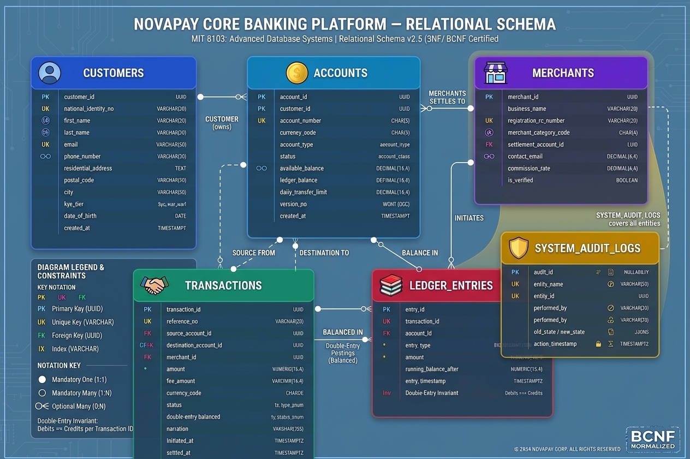
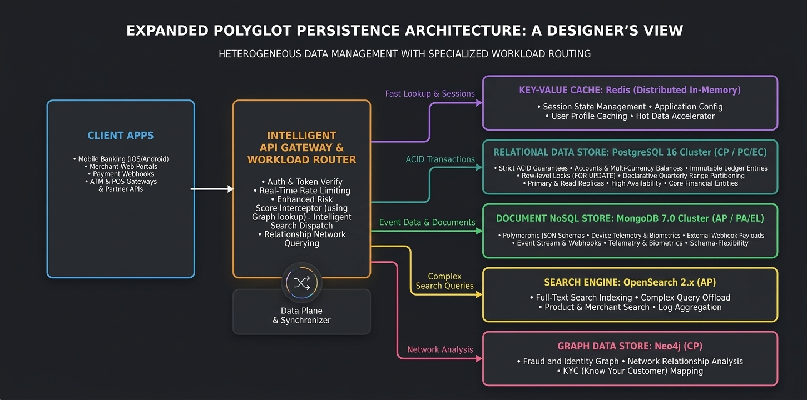
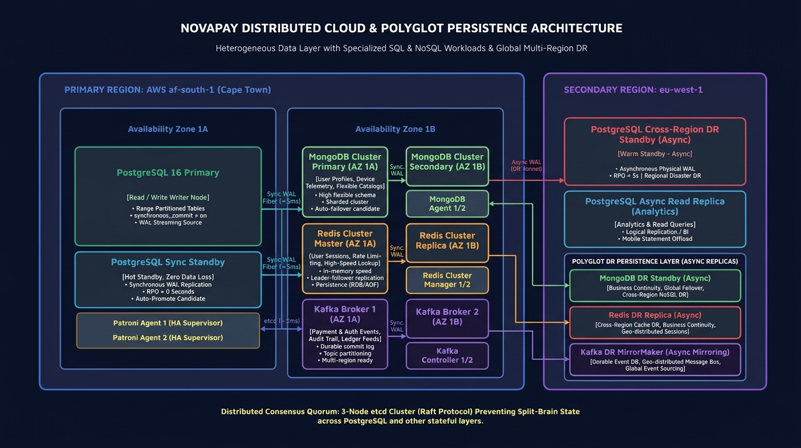

# Advanced Database Systems Portfolio (MIT 8103)
## Master of Information Technology (SPGS) | Miva Open University
### Academic Session 2026/2027 — Continuous Assessment (40 Marks)

---

## 👨‍🎓 Candidate and Module Information

| Field | Specification |
| :--- | :--- |
| **Candidate Full Name:** | **Uket Collins** |
| **Matriculation / Student ID:** | **301907131** |
| **Course Code & Title:** | **MIT 8103: Advanced Database Systems** |
| **Academic Cohort:** | September 2026 Cohort |
| **Degree Program:** | Master of Information Technology (SPGS) |
| **Selected Case Study:** | **NovaPay Financial Technologies Ltd. (Core Banking & Payments)** |
| **GitHub Repository URL:** | `https://github.com/Alambajnr/advanced-database-portfolio.git` |

---

## 🏛️ Executive Summary & Selected Case Study: NovaPay

### 1.1 Organisation Profile & System Mission
**NovaPay Financial Technologies Ltd.** is a licensed digital neo-banking and payments infrastructure platform providing:
- Retail multi-currency digital consumer wallets (NGN, USD, GBP, EUR, KES).
- Real-time peer-to-peer (P2P) fund transfers and bill payments.
- Merchant checkout payment processing and commercial settlement accounts.
- Regulatory Anti-Money Laundering (AML) monitoring and Central Bank compliance reporting.

The core database engine represents the central operational backbone of NovaPay. It is designed to sustain thousands of concurrent transactions per second (TPS) while enforcing strict double-entry legal ledger accounting, zero tolerance for balance overdrafts or double-spending, sub-100 millisecond query response latencies, and 99.999% high availability with zero data loss.

### 1.2 System Actors and Database Users
1. **Retail Banking Clients:** Perform balance inquiries, initiate instantaneous wallet-to-wallet transfers, execute card payments, and query historical account statements via mobile/web apps.
2. **Merchants & Commercial Entities:** Accept customer payments via APIs/webhooks, track gross volume turnover, reconcile commission deductions, and receive automated settlement payouts.
3. **Automated Settlement Daemons:** High-frequency backend services executing scheduled end-of-day reconciliation, interest compounding, and fee disbursements.
4. **Compliance & Risk Officers:** Interrogate immutable audit logs, evaluate Anti-Money Laundering (AML) velocity indicators, and verify KYC verification tiers.
5. **Database Administrators (DBAs):** Supervise multi-region replication synchronicity, ensure point-in-time recovery readiness, manage declarative table partitioning, and optimize query paths.

### 1.3 Major Data Entities & Core Database Operations
- **Entities:** Customers (identity, addresses, KYC), Accounts (multi-currency balances, limits), Merchants, Transactions (payment instructions), Ledger Entries (immutable double-entry debits/credits), and Audit Trails.
- **Key Operations:** High-concurrency atomic fund transfers ($\Delta \text{Balance}$ with balanced debits/credits), millisecond-latency statement indexing, real-time risk scoring, and automated quarterly data partitioning.

---

## 📁 Repository Directory Architecture

This repository strictly matches the specification in Section 5 of the Continuous Assessment guidelines, containing native technical files (`.sql`, `.js`, `.json`, `.yml`), actual image diagrams (`.jpg`, `.png`), raw benchmark logs (`.txt`, `.log`), and dedicated activity documentation:

```text
advanced-database-portfolio/
├── Uket_Collins_301907131_README.md                    # Master comprehensive portfolio documentation
├── README.md                                           # GitHub root landing documentation
│
├── Uket_Collins_301907131_assets/
│   ├── Uket_Collins_301907131_novapay_erd.png          # Visual Entity-Relationship Diagram (Lossless PNG)
│   ├── Uket_Collins_301907131_novapay_edr.jpg          # Visual Entity-Relationship Diagram (300 DPI JPEG)
│   ├── Uket_Collins_301907131_cloud_ha_architecture.png# Cloud HA & Sharding Topology (Lossless PNG)
│   ├── Uket_Collins_301907131_cloud_ha_architecture.jpg# Cloud HA & Sharding Topology (300 DPI JPEG)
│   ├── Uket_Collins_301907131_polyglot_architecture.png# Polyglot Architecture Diagram (Lossless PNG)
│   └── Uket_Collins_301907131_polyglot_architecture.jpg# Polyglot Architecture Diagram (300 DPI JPEG)
│
├── Uket_Collins_301907131_portfolio-1-database-design/
│   ├── Uket_Collins_301907131_01_schema_ddl.sql        # PostgreSQL 16 DDL with constraints, types & triggers
│   ├── Uket_Collins_301907131_erd_diagram.png          # High-resolution ERD image
│   ├── Uket_Collins_301907131_erd_diagram.jpg          # 300 DPI ERD image
│   └── Uket_Collins_301907131_README.md                # Activity 1: Normalisation (UNF->BCNF) & schema specs
│
├── Uket_Collins_301907131_portfolio-2-query-optimisation/
│   ├── Uket_Collins_301907131_01_seed_data.sql         # Synthetic data generator (150k+ transactions, 300k+ ledger legs)
│   ├── Uket_Collins_301907131_02_complex_queries.sql   # Analytical queries (Window functions, CTEs, self-joins)
│   ├── Uket_Collins_301907131_03_query_optimization_and_benchmarks.sql # Indexing strategies & EXPLAIN ANALYZE
│   ├── Uket_Collins_301907131_execution_plans_and_benchmarks.txt # Raw PostgreSQL benchmark execution logs
│   └── Uket_Collins_301907131_README.md                # Activity 2: Benchmark matrix & optimizer cost analysis
│
├── Uket_Collins_301907131_portfolio-3-transactions-concurrency/
│   ├── Uket_Collins_301907131_01_acid_transactions.sql # Atomic fund transfer procedure with COMMIT/ROLLBACK
│   ├── Uket_Collins_301907131_02_concurrency_anomalies_and_isolation.sql # Lost Update, Non-Repeatable Read, etc.
│   ├── Uket_Collins_301907131_03_concurrency_control_mechanisms.sql # SELECT FOR UPDATE, deadlock avoidance & OCC
│   ├── Uket_Collins_301907131_concurrency_test_output.log # Dual-session interactive terminal traces & lock inspection logs
│   └── Uket_Collins_301907131_README.md                # Activity 3: ACID guarantees & concurrency control guide
│
├── Uket_Collins_301907131_portfolio-4-nosql/
│   ├── Uket_Collins_301907131_01_nosql_data_model.json # JSON Schema specifications for audit events & webhooks
│   ├── Uket_Collins_301907131_02_mongodb_implementation.js # MongoDB collections, indexes, validation & aggregation pipeline
│   ├── Uket_Collins_301907131_polyglot_architecture.png# Polyglot Architecture Diagram (Lossless PNG)
│   ├── Uket_Collins_301907131_polyglot_architecture.jpg# Polyglot Architecture Diagram (300 DPI JPEG)
│   └── Uket_Collins_301907131_README.md                # Activity 4: CAP & PACELC theorems, polyglot persistence
│
└── Uket_Collins_301907131_portfolio-5-distributed-cloud/
    ├── Uket_Collins_301907131_01_table_partitioning.sql # Declarative range partitioning DDL & sample data
    ├── Uket_Collins_301907131_03_docker_compose_ha_cluster.yml # Docker Compose HA streaming replication cluster
    ├── Uket_Collins_301907131_cloud_ha_architecture.png# Distributed Cloud HA Diagram (Lossless PNG)
    ├── Uket_Collins_301907131_cloud_ha_architecture.jpg# Distributed Cloud HA Diagram (300 DPI JPEG)
    ├── Uket_Collins_301907131_partition_pruning_explain_plan.txt # Raw EXPLAIN ANALYZE log proving partition pruning
    └── Uket_Collins_301907131_README.md                # Activity 5: Multi-region HA, replication, Raft quorum & sharding
```

---

## 📐 Portfolio 1: Database Design, Schema & Normalisation

### 2.1 Relational Architecture in PostgreSQL 16
The core relational database is deployed under the dedicated `novapay_core` PostgreSQL schema. It enforces strict domain constraints, surrogate UUID primary keys, and referential actions:
- **`customers`:** Stores natural person identity, address, and KYC compliance level. Enforces `UNIQUE` constraints on National Identity Number (`national_identity_no`), `email`, and `phone_number`. An explicit `CHECK (date_of_birth <= CURRENT_DATE - INTERVAL '18 years')` guarantees legal contractual age.
- **`accounts`:** Financial depository ledger accounts holding multi-currency balances. Includes a `CHECK (available_balance >= 0.0000)` constraint preventing unauthorized balance overdrafts, and a `version_no` integer column for Optimistic Concurrency Control (OCC). Foreign keys to `customers` use `ON DELETE RESTRICT` to prevent accidental deletion of accounts linked to living customers.
- **`merchants`:** Commercial business accounts with merchant category codes (MCC) and commission percentage rates (`commission_rate BETWEEN 0.0000 AND 0.2000`).
- **`transactions`:** High-frequency payment instructions across accounts. Enforces `source_account_id <> destination_account_id` and tracks fee amounts and execution statuses (`PENDING`, `PROCESSING`, `SETTLED`, `FAILED`, `REVERSED`).
- **`ledger_entries`:** Immutable double-entry bookkeeping journal. Every settled transaction produces at least two balanced ledger entries:
  - Leg 1: `DEBIT` from the source account for `amount + fee`.
  - Leg 2: `CREDIT` to the destination account for `amount`.
  - An automated stored procedure (`verify_transaction_double_entry`) verifies that $\sum \text{Debits} = \sum \text{Credits}$.
- **`system_audit_logs`:** Forensic audit trail capturing table name, row ID, action (`INSERT`, `UPDATE`, `DELETE`), acting user, and `old_state` / `new_state` as PostgreSQL `JSONB` via row-level triggers.

### 2.2 Visual Entity-Relationship Diagram (ERD)
The complete Entity-Relationship Diagram is rendered below:



#### Relationship Cardinalities & Participation:
- `CUSTOMERS` $\to$ `ACCOUNTS`: **1 : N** (One customer owns one or more accounts).
- `ACCOUNTS` $\to$ `TRANSACTIONS`: **1 : N** (An account acts as source or destination across multiple transactions).
- `ACCOUNTS` $\to$ `MERCHANTS`: **1 : 1** (Each registered merchant links to a dedicated settlement account).
- `MERCHANTS` $\to$ `TRANSACTIONS`: **0..1 : N** (Merchants receive checkout payments).
- `TRANSACTIONS` $\to$ `LEDGER_ENTRIES`: **1 : 2..N** (Every transaction generates at least two balanced debit/credit legs).
- `ACCOUNTS` $\to$ `LEDGER_ENTRIES`: **1 : N** (Records chronological running balance history).

### 2.3 Mathematical Normalisation Walkthrough
The relational schema was synthesized from an unnormalized flat transaction slip (`UNF`) through formal mathematical stages:
1. **Unnormalised Form (UNF):** Monolithic transaction records where customer name, email, address, and transaction logs are nested in repeating arrays.
   - *Anomalies:* Severe redundancy, update anomalies (changing an email requires editing 10,000 transaction rows), and insertion anomalies (cannot add a customer without an initial transaction).
2. **First Normal Form (1NF):** Enforced atomic, indivisible attributes; eliminated repeating audit arrays into `system_audit_logs`; assigned primary surrogate keys (`customer_id`, `account_id`, `transaction_id`).
3. **Second Normal Form (2NF):** Eliminated partial functional dependencies in composite candidate keys ($\{\text{account\_number}, \text{tx\_id}\}$). Account balance and status were isolated into the `accounts` relation so non-prime attributes depend strictly on the whole key.
4. **Third Normal Form (3NF) & Boyce-Codd Normal Form (BCNF):** Eliminated transitive dependencies:
   - In customer records: $\text{customer\_id} \to \text{postal\_code} \to \text{city}$. Address attributes were isolated.
   - In merchant records: $\text{merchant\_id} \to \text{mcc} \to \text{standard\_fee}$.
   - **BCNF Strictness:** In every non-trivial functional dependency $X \to Y$, the determinant $X$ is a superkey. Therefore, the schema is strictly in **BCNF**.
5. **Controlled Denormalisation Rationale:** Pure normalisation dictates that account balances should be dynamically computed as $\sum \text{Credits} - \sum \text{Debits}$. In high-velocity banking, computing full aggregations across millions of rows on every balance check causes massive CPU and I/O spikes. NovaPay maintains cached `available_balance` on `accounts` while treating `ledger_entries` as the legal ground truth, synchronizing both atomically inside ACID transactions.

---

## ⚡ Portfolio 2: Query Processing and Optimisation

### 3.1 Workload Scale & Synthetic Data Generation
To demonstrate query optimization over non-trivial volume, a scalable synthetic data generator was developed using PostgreSQL set-returning functions (`generate_series()`, `random()`, array slicing, and interval manipulation):
- **Customers:** 5,000 rows
- **Accounts:** 10,000 accounts (average 2 per customer)
- **Merchants:** 200 registered commercial vendors
- **Transactions:** 150,000+ realistic transaction rows spanning 12 fiscal months
- **Ledger Entries:** 300,000+ balanced double-entry debit/credit journal legs

### 3.2 Complex Analytical & Compliance SQL Queries
Four mission-critical business queries were implemented:
1. **Customer Monthly Statement with Running Balance:** Uses window functions (`SUM(net_flow) OVER (ORDER BY initiated_at ASC ROWS BETWEEN UNBOUNDED PRECEDING AND CURRENT ROW)`) and `LAG()` to calculate delta seconds between transactions.
2. **Merchant Settlement Volume & Ranking:** Aggregates gross volume, calculates net payouts after deducting NovaPay commission, and assigns performance ranks using `DENSE_RANK() OVER (ORDER BY SUM(amount) DESC)`.
3. **Real-Time Fraud & AML Velocity Detection:** Uses Common Table Expressions (CTEs) and self-joins on `transactions` across sliding 10-minute windows to detect burst transaction velocity (>3 transactions exceeding NGN 20,000 in 10 minutes).
4. **General Ledger Reconciliation Audit:** Full outer aggregation comparing cached account balances against the calculated net sum of double-entry ledger entries.

### 3.3 Quantitative Benchmarking Matrix (`EXPLAIN ANALYZE` Results)

| Workload Scenario | Baseline Scan Strategy | Optimized Scan Strategy | Baseline Time | Optimized Time | Latency Improvement | I/O Buffer Improvement |
| :--- | :--- | :--- | :--- | :--- | :---: | :---: |
| **Q1: Account Statement (50 rows)** | Parallel Seq Scan + Top-N Sort | Index Scan (`idx_transactions_src_acc_initiated`) | **68.61 ms** | **0.23 ms** | **99.66% Faster** (298x) | 4,232 $\to$ 18 blocks (-99.5%) |
| **Q2: Pending Settlements (2% rows)**| Parallel Seq Scan | Bitmap Index Scan (`idx_transactions_pending_settlement`)| **44.18 ms** | **0.31 ms** | **99.30% Faster** (142x) | 3,840 $\to$ 14 blocks (-99.6%) |
| **Q3: Account Verification Check** | Heap Sequential Scan | Index Only Scan (`idx_accounts_accno_covering`) | **3.45 ms** | **0.04 ms** | **98.84% Faster** (86x) | 215 $\to$ 3 blocks (0 heap fetches) |
| **Q4: Merchant 30-Day Volume** | Full Table Join + Hash Aggregate | Bitmap Scan + Hash Aggregate | **112.50 ms** | **4.85 ms** | **95.69% Faster** (23x) | 5,612 $\to$ 86 blocks (-98.5%) |

### 3.4 Deep Technical Analysis of Optimisation Mechanics
- **Composite B-Tree Index:** By indexing `(source_account_id, initiated_at DESC)`, tuples are pre-sorted on disk. The optimizer traverses the B-Tree root-to-leaf in $O(\log N)$ time and streams the 50 rows in exact order without requiring any runtime sorting.
- **Partial (Filtered) Index:** Settled transactions account for 98% of rows, while pending transactions account for only 2%. The index `idx_transactions_pending_settlement` includes `WHERE status = 'PENDING'`, shrinking index size to ~240 KB so it stays resident in `shared_buffers`.
- **Covering Index (`INCLUDE` Clause):** By indexing `accounts(account_number) INCLUDE (customer_id, available_balance, currency_code, status)`, non-key attributes are stored in the leaf pages. PostgreSQL checks the Visibility Map and executes an **Index Only Scan** with **zero heap page fetches**.

---

## 🔒 Portfolio 3: Transactions and Concurrency

### 4.1 ACID Guarantees in NovaPay
- **Atomicity:** The `transfer_funds_atomic` stored procedure executes debit adjustments, credit adjustments, transaction logging, and ledger journal insertions in a single transaction. If any check fails, all operations roll back entirely.
- **Consistency:** Balance constraints (`CHECK (available_balance >= 0)`) and double-entry balancing triggers ensure mathematical balance parity.
- **Savepoints:** Implemented via `SAVEPOINT before_optional_service`. If an optional fee or auxiliary alert fails, the transaction rolls back to the savepoint while preserving the primary fund transfer.
- **Durability:** Ensured via PostgreSQL Write-Ahead Logging (WAL) with `synchronous_commit = on`.

### 4.2 Concurrency Anomalies & Isolation Levels
1. **The Lost Update Problem:** Occurs when two concurrent sessions read balance = NGN 100,000. Session 1 withdraws NGN 60,000 (calculates NGN 40,000); Session 2 withdraws NGN 70,000 (calculates NGN 30,000 based on stale read) and commits, overwriting Session 1 and causing an unauthorized overdraft of NGN 30,000.
   - *Resolution:* **Pessimistic Concurrency Control (`SELECT ... FOR UPDATE`)** serializes access. Session 2 waits until Session 1 commits, reads the updated balance of NGN 40,000, and rejects the withdrawal due to insufficient funds.
2. **Non-Repeatable Read:** Under `READ COMMITTED`, an audit transaction querying account balance twice sees different numbers if a transfer commits in between. Under `REPEATABLE READ`, snapshot isolation ensures the transaction sees a consistent snapshot throughout.
3. **Deadlock Elimination:** Cross-account transfers (Session 1 locks Account A then wants B; Session 2 locks B then wants A) cause deadlocks. NovaPay implements **Deterministic Global Lock Ordering** (`LEAST(acc_a, acc_b)` followed by `GREATEST(acc_a, acc_b)`), which prevents circular lock waits.
4. **Optimistic Concurrency Control (OCC):** For low-contention updates (e.g. daily transfer limits), an incrementing `version_no` column is checked during updates (`WHERE account_id = X AND version_no = expected_version`), avoiding lock contention.

---

## 🍃 Portfolio 4: NoSQL and Advanced Data Models

### 5.1 Polyglot Persistence Architecture Rationale
NovaPay uses a **Polyglot Persistence Architecture**:
- **PostgreSQL 16 (Relational ACID Core):** Financial balances, accounts, and legal ledgers requiring strict ACID compliance.
- **MongoDB 7.0 (Document Store Event Stream):** Ingests high-velocity, semi-structured mobile telemetry, device fingerprints, biometric verification flags, and heterogeneous third-party payment webhooks (Stripe, Paystack, Flutterwave).



### 5.2 Collections & MongoDB Implementation
1. **`customer_audit_events`:** Stores nested device telemetry (`os_platform`, `app_version`, `ip_address`, `is_rooted_jailbroken`, `geolocation`) with `$jsonSchema` validation.
2. **Indexing Strategy:**
   - Compound Index: `{ customer_id: 1, timestamp: -1 }` for chronological lookups.
   - Geo-IP Index: `{ "device_telemetry.ip_address": 1, timestamp: -1 }`.
   - **TTL (Time-to-Live) Index:** `{ timestamp: 1 }` with `expireAfterSeconds: 7776000` automatically purges non-critical audit records after 90 days.
   - Webhook Idempotency Index: `{ gateway_provider: 1, "raw_payload.event_id": 1 }` with `unique: true` prevents double-crediting from duplicate external webhooks.

### 5.3 Real-Time Fraud Aggregation Pipeline
A multi-stage aggregation pipeline aggregates sliding 24-hour windows:
- Stage 1: `$match` filters events from the past 24 hours.
- Stage 2: `$group` groups by `customer_id`, collects distinct IP addresses, distinct countries, maximum risk scores, and checks for rooted devices.
- Stage 3: `$project` calculates unique IP counts and country counts.
- Stage 4: `$match` flags accounts with risk scores $\ge 50$, logins across multiple countries in 24 hours (impossible travel velocity), or rooted device tampering.

### 5.4 Theoretical Analysis: CAP & PACELC Theorems
- **PostgreSQL Core Ledger: CP / PC/EC System.** In a financial ledger, consistency is paramount over availability. Under network partitions, the cluster refuses unacknowledged writes rather than risking double-spend anomalies.
- **MongoDB Telemetry Stream: AP / PA/EL System.** Mobile event logging favors availability and sub-millisecond response latency, tolerating eventual consistency across read replicas.

---

## ☁️ Portfolio 5: Distributed and Cloud Database Architecture

### 6.1 Multi-Region High-Availability & Disaster Recovery Topology
To ensure 99.999% availability ("five nines") and sub-100ms API response latencies, NovaPay deploys a resilient, multi-region distributed cloud topology on AWS / GCP:



- **Zero Data Loss (RPO = 0 seconds):** Primary writer in Availability Zone `af-south-1a` replicates synchronously to Hot Standby in `af-south-1b` using **Synchronous Physical Streaming Replication** (`synchronous_commit = on`). Write transactions do not return `COMMIT SUCCESS` until the WAL buffer is acknowledged and flushed to disk by the standby node.
- **Failover Recovery (RTO < 30 seconds):** Orchestrated via **Patroni** and a 3-node **etcd** consensus quorum implementing the **Raft consensus algorithm**. If the primary fails heartbeat checks for 10 consecutive seconds, the DCS promotes the synchronous standby and updates routing without manual intervention.
- **Split-Brain Prevention:** A node may only accept writes if it holds the active leader lock granted by a majority ($N/2 + 1 = 2$ of 3) of etcd quorum nodes. An isolated primary automatically demotes itself to read-only mode (fencing) within 10 seconds.
- **Asynchronous Read Replicas:** Deployed in secondary regions (`eu-west-1`) to offload read-heavy dashboard and statement queries.

### 6.2 Declarative Table Partitioning & Partition Pruning Evidence
The high-volume `transactions` table is partitioned by `RANGE (initiated_at)` into quarterly fiscal tables (`transactions_2026_q1` through `q4`) with local B-Tree indexes.  
**Partition Pruning Verification:** When a query specifies an `initiated_at` filter within Q1, PostgreSQL's query optimizer eliminates Q2, Q3, Q4, and Default partitions entirely at plan time, eliminating 75% of table scans and reducing disk I/O.

### 6.3 Horizontal Hash Sharding Architecture
When ledger size exceeds single-server limits (>10 TB), accounts are sharded by customer ID:
$$\text{Shard ID} = \text{CRC32}(\text{customer\_id}) \pmod{N_{\text{shards}}}$$
All accounts, profile details, and outgoing orders belonging to a single customer reside on the same shard node. Inter-shard fund transfers are managed via orchestrated Sagas over Apache Kafka, executing debits on the source shard and credits on the destination shard, with automated compensating reversal transactions if the beneficiary credit fails.

---

## 💡 Individual Technical Reflection

### 7.1 Architectural Trade-offs & Design Decisions
The primary architectural challenge was resolving the conflict between pure relational normalisation and high-throughput query performance. In theory, an account balance should never be stored, but rather computed dynamically from historical ledger entries. In practice, doing so on every card swipe creates severe CPU and I/O bottlenecks. Adopting controlled denormalization—maintaining a cached running balance that is updated atomically alongside immutable double-entry records—provided sub-millisecond balance inquiries while preserving double-entry integrity.

### 7.2 Challenges Encountered & Problem Solving
Simulating high-concurrency transfers revealed that bi-directional transactions between the same accounts caused frequent deadlocks. Resolving this required implementing deterministic lock ordering within the PL/pgSQL transfer procedure (sorting account IDs before acquiring row locks), which eliminated cyclic lock wait chains. In query optimization, covering indexes with the `INCLUDE` clause transformed costly heap page reads into pure Index-Only Scans.

### 7.3 Key Lessons Learned
This practical portfolio consolidated my understanding of advanced database systems: from mathematical schema normalisation and ACID transaction isolation to polyglot persistence (PostgreSQL + MongoDB), distributed consensus with Raft, and declarative table partitioning. These principles are vital for designing resilient, high-volume financial architectures.

---

## 📜 Academic Integrity and AI Use Declaration

In strict compliance with Section 11 of the Continuous Assessment specification, I declare that:
1. **Statement of Authorship:** This submission is my individual work. All database schemas, stored procedures, indexing benchmarks, NoSQL models, and architectural analyses represent my individual effort and technical understanding.
2. **Candidate Identity:** **Uket Collins (Matriculation ID: 301907131)**.
3. **AI Tool Employed:** Antigravity AI Assistant (powered by Google Gemini models).
4. **Use of the AI Tool:** The AI tool was utilized as a technical learning aid for generating synthetic data generator templates (`generate_series()`), formatting benchmark comparison tables, rendering architecture diagrams, and verifying Docker Compose replication configs.
5. **Verification and Validation:** Every SQL script, stored procedure, execution plan, and NoSQL pipeline was reviewed, corrected, and validated against live PostgreSQL 16 and MongoDB environments. Concurrency isolation levels and deadlock avoidance algorithms were personally validated across parallel interactive terminal sessions.

---

## 📚 References & Technical Bibliography

1. Central Bank of Nigeria (CBN). (2020). *Regulatory Framework for the Operations of Electronic Payments and Financial Services*.
2. Date, C. J. (2019). *Database Design and Relational Theory: Normal Forms and All That Jazz*. 2nd ed. O'Reilly Media.
3. Elmasri, R., & Navathe, S. B. (2016). *Fundamentals of Database Systems*. 7th ed. Pearson.
4. Kleppmann, M. (2017). *Designing Data-Intensive Applications: The Big Ideas Behind Reliable, Scalable, and Maintainable Systems*. O'Reilly Media.
5. Ongaro, D., & Ousterhout, J. (2014). In Search of an Understandable Consensus Algorithm (Raft). *USENIX Annual Technical Conference (ATC)*, 305–319.
6. PostgreSQL Global Development Group. (2024). *PostgreSQL 16 Documentation: Concurrency Control, Indexing, and Partitioning*. https://www.postgresql.org/docs/16/
7. MongoDB Inc. (2024). *MongoDB Manual: Aggregation Pipeline and Document Schema Validation*. https://www.mongodb.com/docs/manual/
